# Arduino Coffee Machine Prototype

A menu-driven coffee machine prototype built on an Arduino Uno (ATmega328P) and programmed in Flowcode v10. It was a solo university project, completed in about 2 weeks.

## What it does
The machine shows a menu on an LCD and lets the user choose a drink with push buttons:

- **Button 0: Maxi coffee.** The LCD shows "water heater turns on" and the temperature sensor is read continuously. When the temperature is at least 20 °C and below 30 °C, the buzzer beeps and the DC motor pumps water for 20 seconds, with a live countdown on the LCD. Then it shows "coffee ready".
- **Button 1: Espresso.** The same sequence, with the DC motor running for 10 seconds.
- **Button 3: Emergency stop.** The LCD shows "emergency stop", the buzzer beeps 10 times, and the machine returns to the main menu. It works at every stage: while waiting for the right temperature and during the DC motor countdown.

The water heater and DC motor are represented by messages and a countdown on the LCD, not by physical parts.

## Hardware and components
- Arduino Uno (ATmega328P)
- LCD display (BL0169)
- EBLOCKS 2 switch board (BL0145): button 0 = Maxi, button 1 = Espresso, button 3 = Emergency
- Grove SHT31 temperature and humidity sensor (only temperature is used)
- Buzzer

## How it works
1. At start-up the LCD and temperature sensor are initialised and a welcome message is shown for 3 seconds.
2. The program waits for a button press and uses a Switch block to choose the Maxi, Espresso or Emergency path.
3. In the heating stage, a loop reads the temperature until it is at least 20 °C and below 30 °C, or until the emergency button is pressed.
4. A countdown on the LCD shows the remaining time while the DC motor runs. The emergency button is checked every second.
5. Delays slow the program down so messages can be read on the LCD.
6. After each drink or emergency stop, the program returns to the main menu.

## Demo on Arduino hardware
PASTE YOUR VIDEO LINK HERE

## Simulation (Flowcode)
Screenshots from the Flowcode simulator, showing the LCD, temperature sensor, switch board and buzzer.

**Start-up and menu**

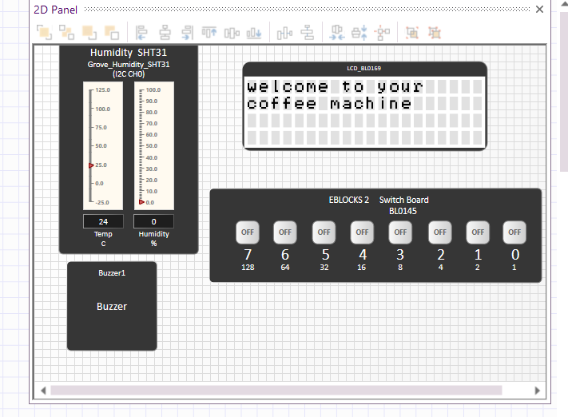
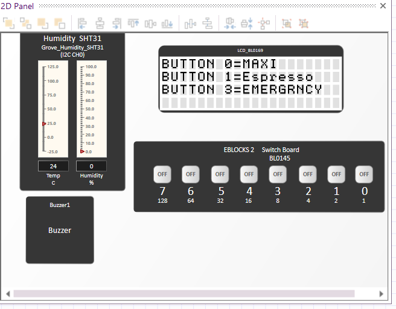

**Emergency stop**

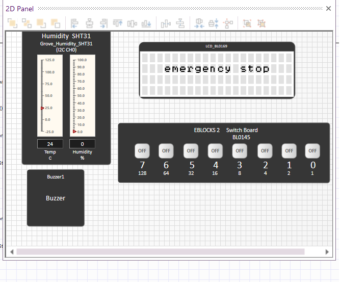

**Maxi coffee (button 0)**

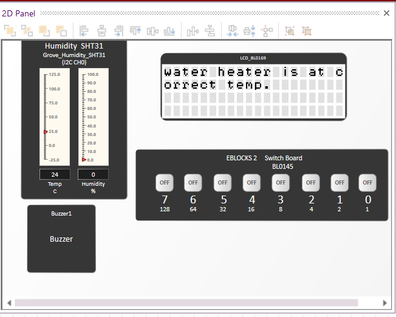
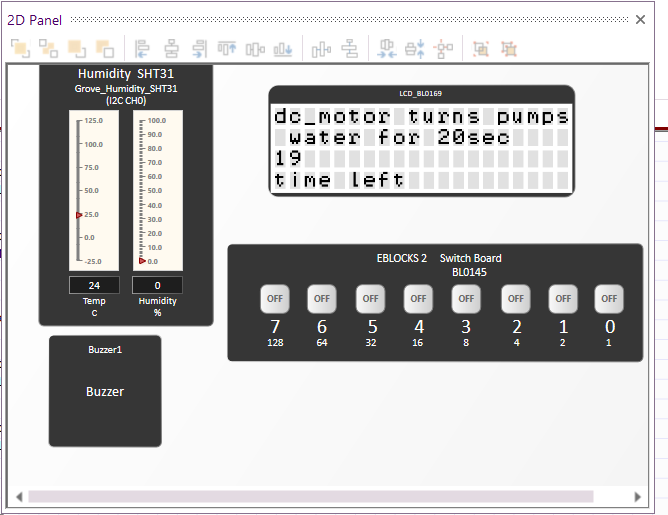

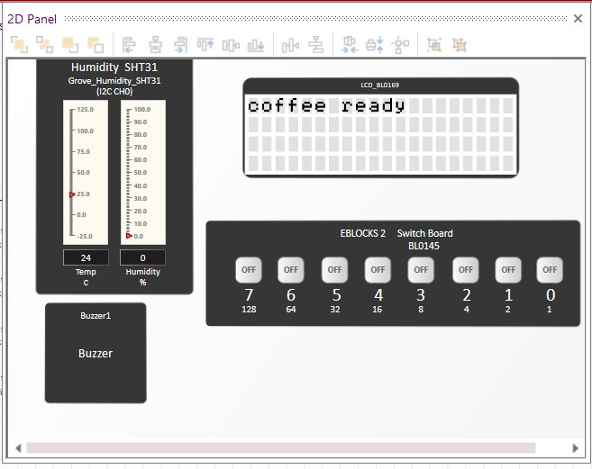

**Espresso (button 1)**

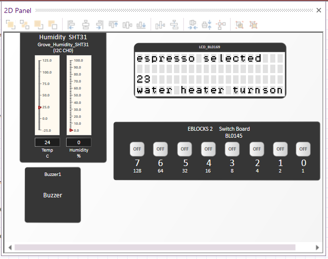
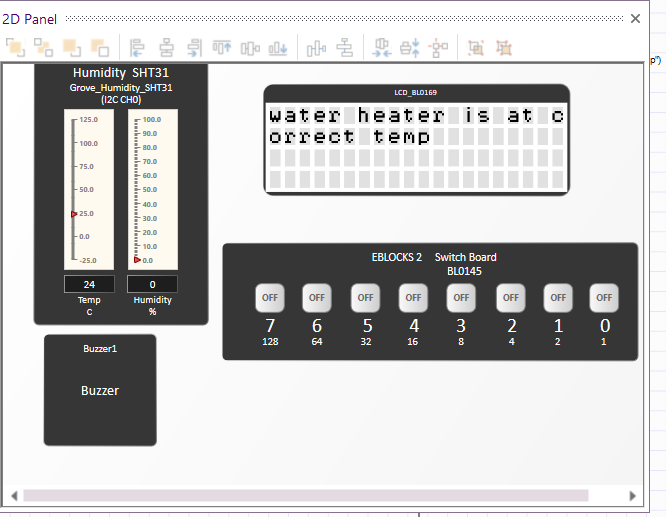
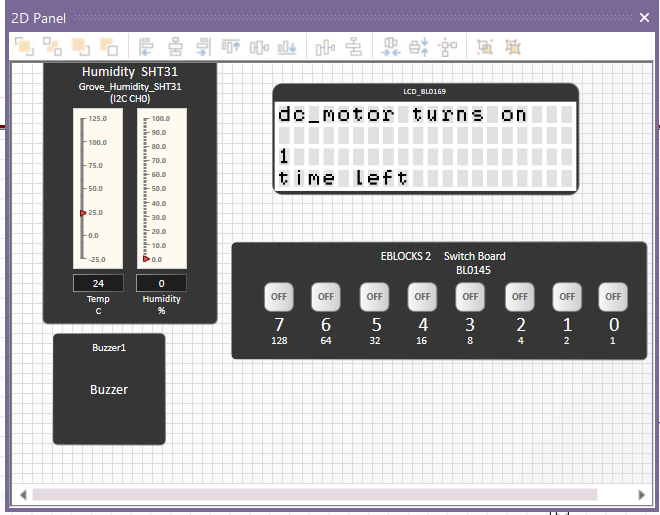
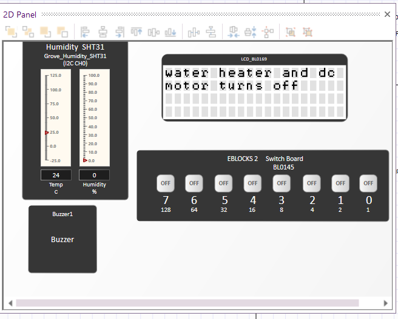

## Flowchart
Overview of the whole program:

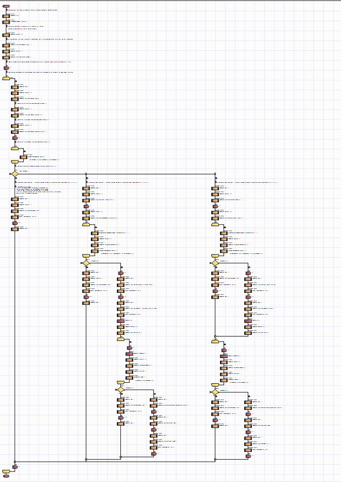

**Start-up and menu**

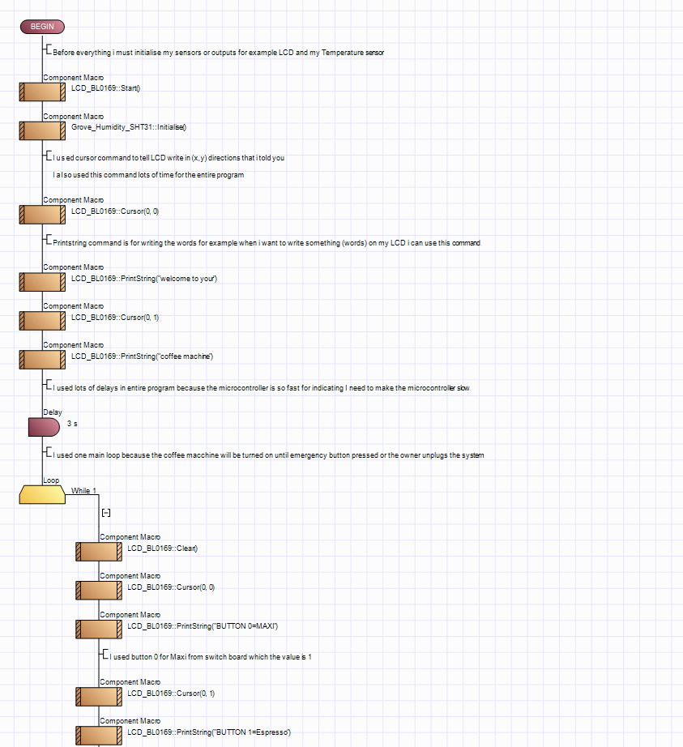
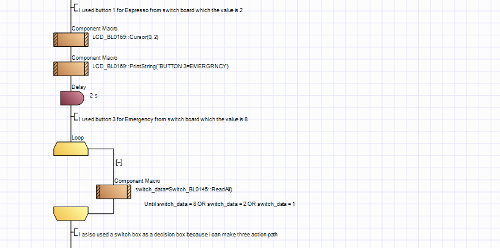

**Choosing a path (Switch block)**

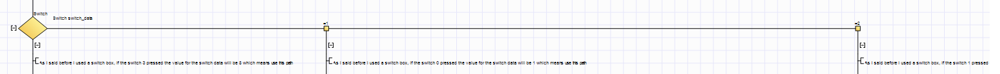

**Emergency stop path**

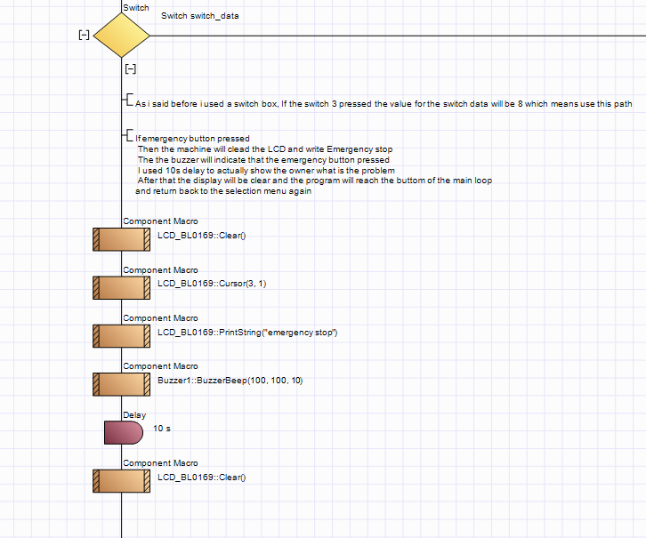

**Maxi coffee path**

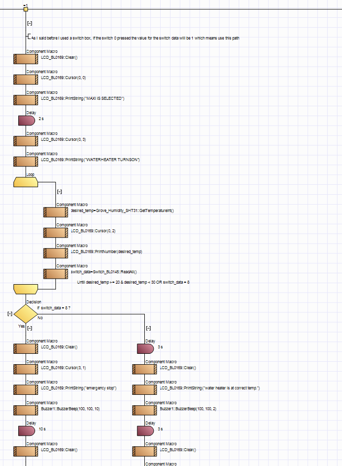
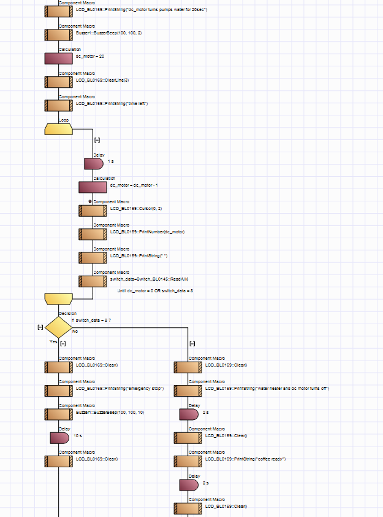
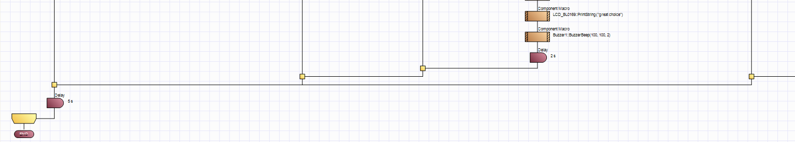

**Espresso path**

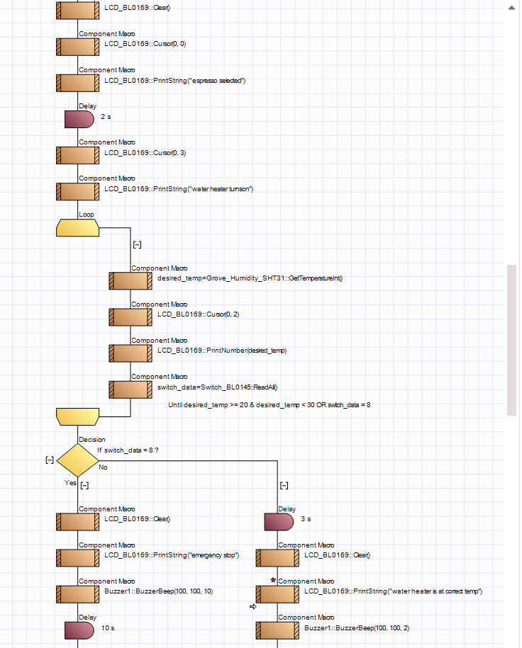
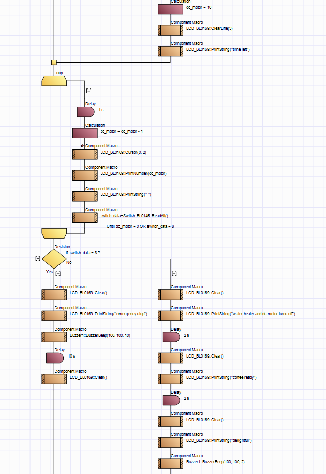
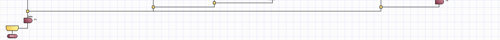

## Challenges I solved
1. **Stuck in the temperature loop.** At first, if the temperature was never in the correct range, the program stayed in the temperature-reading loop with no way out. I fixed this by reading the switch board inside that loop and exiting if button 3 is pressed. The machine now goes straight to the emergency stop and back to the main menu.
2. **Emergency button ignored during the countdown.** While reviewing my flowchart, I noticed the countdown loops read the switch board but never stored the result in `switch_data`, so button 3 was not detected during the DC motor countdown. I changed the block to `switch_data = Switch_BL0145::ReadAll()` in both the Maxi and Espresso countdowns, and tested that the emergency stop now works at every stage.
3. **Countdown text overwritten on the LCD.** The countdown number was printed at the start of the "time left" line, so it overwrote the first letters (it showed "15 e left"). I moved the number to its own line with `Cursor(0, 2)`, so the LCD now shows the number above "time left" in both the Maxi and Espresso countdowns.

## What I would improve
- Use a real heater and DC motor, with a higher target temperature for hot drinks.
- Add LEDs or a display bar to show the machine status and progress.

## Files
- `coffee_machine.fcfx`: Flowcode project file
- `coffee_machine.c`: generated C code. My program starts at `Use :User Project` (`int main()` is near the end). Everything above that is Flowcode's built-in library code.
- `images/`: simulation screenshots and flowchart sections
